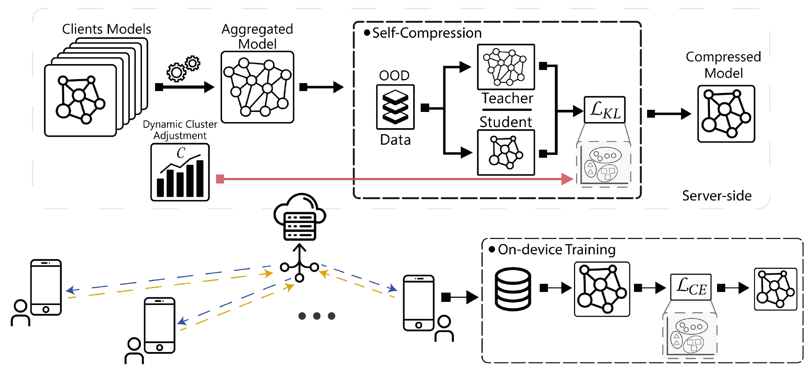

# FedCompress

**Communication-Efficient Federated Learning through Adaptive Weight Clustering and Server-Side Distillation**

Vasileios Tsouvalas, Aaqib Saeed, Tanir Ozcelebi, Nirvana Meratnia<br>
IEEE ICASSP 2024, pp. 5805–5809

[ Paper](https://doi.org/10.1109/ICASSP48485.2024.10447174) · [ Project](https://nousphera.github.io/projects/fedcompress/) · [ Poster](https://nousphera.github.io/assets/posters/fedcompress-a0-landscape.pdf) · [Citation](#citation)

## Abstract

Repeated model exchange makes communication a major cost in federated learning. FedCompress combines adaptive weight clustering at the clients with server-side knowledge distillation. After aggregation, a clustered student learns from the global model on unlabeled auxiliary data, while client representation scores guide the number of weight clusters. This couples model training with compression in both communication directions.

<p align="center">
  
</p>

*Weight clustering compresses client uploads. After aggregation, server-side distillation restores a clustered global model for the return trip, while a representation-quality score adjusts the number of clusters. [Figure 1 in the public preprint](https://arxiv.org/pdf/2401.14211v3#page=2).*

## Installation

Use Python 3.11 and a dedicated virtual environment. The Flower simulation uses Flower 1.13.1 and Ray 2.10.0. Create both the checkout and environment on paths without spaces so Ray can start its workers. Install the pinned stack together to keep TensorFlow 2.15 and protobuf compatible.

```bash
mkdir -p "$HOME/research-code" "$HOME/.venvs"
cd "$HOME/research-code"
git clone https://github.com/Nousphera/FedCompress.git
cd FedCompress
python3.11 -m venv "$HOME/.venvs/fedcompress"
source "$HOME/.venvs/fedcompress/bin/activate"
python -m pip install -r requirements.txt
python -m pip check
```

## Data

```bash
python scripts/prepare_data.py --dataset cifar10 --root datasets --download
python scripts/prepare_data.py --dataset cifar10 --root datasets --validate
```

The [dataset guide](docs/DATA_SETUP.md) also covers CIFAR-100, PathMNIST,
Speech Commands, and VoxForge. Server distillation uses an auxiliary corpus of
RGB images or mono 16 kHz WAVs. For image experiments:

```bash
python scripts/prepare_data.py --dataset ood-images --source /path/to/stylegan-images --root data/stylegan
python scripts/prepare_data.py --dataset ood-images --root data/stylegan --validate
```

## Training

Start a two-client, two-round simulation with local clustering and server
distillation on generated data:

```bash
flwr run .
python scripts/check_run.py runs/flower-smoke --rounds 2
```

For prepared CIFAR-10 and auxiliary images:

```bash
flwr run . paper --run-config 'options="--dataset cifar10 --data-root datasets --ood-dir data/stylegan --clients 20 --rounds 20 --epochs 10 --warmup-epochs 5 --server-epochs 10 --seed 42 --output runs/cifar10"'
```

`--method fedcompress` enables both components. `client` enables local clustering
alone; `fedavg` uses neither clustering nor server distillation. The latter two
modes need no auxiliary corpus. The sequential runner uses the same core:

```bash
python train.py --dataset synthetic --clients 2 --rounds 2 --epochs 2 \
  --warmup-epochs 1 --server-epochs 1 --batch-size 8 --min-clusters 2 \
  --max-clusters 3 --output runs/sequential
```

## Evaluation

Each round evaluates the aggregated model on the test split. FedCompress then
evaluates the server-compressed model after distillation. In Flower outputs,
`rounds[].metrics.accuracy` and `rounds[].metrics.compressed_accuracy` hold
these accuracies; the sequential runner puts the post-compression value in
`rounds[].accuracy`. Accuracies are fractions.

```bash
python -m json.tool runs/cifar10/results.json
```

Run `--method fedavg` and `--method client` in separate output directories for
component comparisons. The sequential runner also records upstream and
downstream protobuf bytes; [Method settings](docs/METHODS.md) define this
measurement separately from model-file compression.

## Configuration and outputs

Use a new output directory for each run. `results.json` records configuration,
versions, participating clients, example counts, effective rank, cluster counts,
metrics, and serialized message bytes. `final-parameters.npz` and the Keras H5
exports store the final model weights, including server distillation.

The Flower simulation uses local Ray workers and a shared filesystem for client
state. Set the federation's `options.num-supernodes` to match `--clients`;
`options` replaces the complete training argument string. See
[Flower execution](docs/FLOWER_APP.md) for resource settings.

[Method settings](docs/METHODS.md) describe convolution-only clustering,
sample-weighted effective rank, plateau scheduling, and the distinction between
protobuf byte counts and model-file sizes. [Data formats](docs/DATA_FORMATS.md)
specify the audio frontend and source-bound TFDS label caches. See
[testing](docs/TESTING.md) for regression and output checks.

## Results

Reported values from [Table 1 of the paper’s public preprint](https://arxiv.org/pdf/2401.14211v3#page=5): 20 clients, 20 rounds, ten local epochs and ten server-distillation epochs per round; client data-distribution variance 25%. Accuracy is averaged over two trials. Δ accuracy is relative to FedAvg in percentage points; communication reduction includes both directions.

| Dataset | FedAvg accuracy (%) | FedCompress Δ accuracy (pp) | Communication reduction (×) |
| --- | --- | --- | --- |
| CIFAR-10 | 86.26 | −1.83 | 4.53 |
| CIFAR-100 | 60.68 | −1.88 | 3.80 |
| PathMNIST | 88.22 | −1.72 | 4.79 |
| SpeechCommands | 95.75 | −0.42 | 5.04 |
| VoxForge | 81.05 | −0.31 | 5.41 |

FedCompress reduces communication by 3.80–5.41× across these tasks, with accuracy changes between −1.88 and −0.31 percentage points.

## Citation

If you use this work, please cite:

```bibtex
@inproceedings{tsouvalas2024fedcompress,
  title = {Communication-Efficient Federated Learning through Adaptive Weight Clustering and Server-Side Distillation},
  author = {Vasileios Tsouvalas and Aaqib Saeed and Tanir Ozcelebi and Nirvana Meratnia},
  booktitle = {ICASSP 2024 - 2024 IEEE International Conference on Acoustics, Speech and Signal Processing (ICASSP)},
  year = {2024},
  pages = {5805--5809},
  doi = {10.1109/ICASSP48485.2024.10447174},
  url = {https://arxiv.org/abs/2401.14211},
  eprint = {2401.14211},
  archivePrefix = {arXiv}
}
```

Machine-readable metadata: [CITATION.cff](CITATION.cff) · [BibTeX](citation.bib).

## License

Contact the authors for software reuse terms. YAMNet terms are included in [licenses/THIRD_PARTY.txt](licenses/THIRD_PARTY.txt). External datasets and models retain their own terms.
