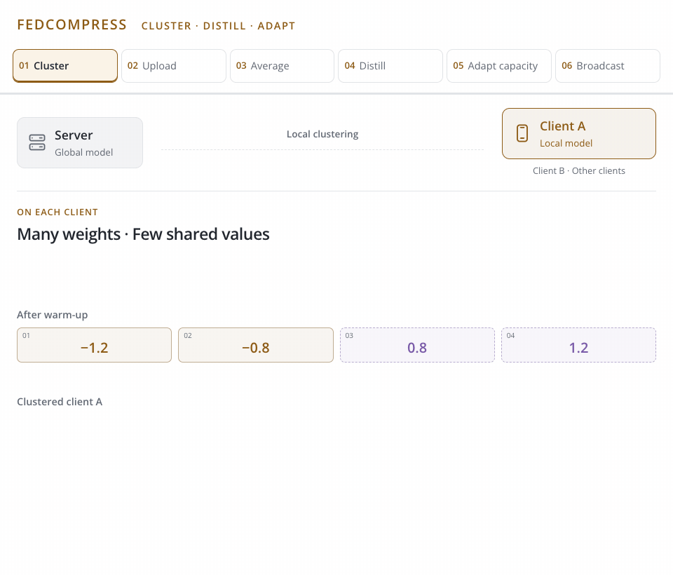

<h1 align="center">FedCompress</h1>
<p align="center"><strong>Communication-Efficient Federated Learning through<br>Adaptive Weight Clustering and Server-Side Distillation</strong></p>
<p align="center"><a href="https://vtsouval.github.io/"><strong>Vasileios Tsouvalas</strong></a> · Aaqib Saeed · Tanir Özçelebi · Nirvana Meratnia</p>

<p align="center">
  <a href="https://doi.org/10.1109/ICASSP48485.2024.10447174" title="Read the paper"></a>
  <picture></picture>
  <a href="https://nousphera.github.io/FedCompress/" title="Explore the project"></a>
  <picture></picture>
  <a href="https://nousphera.github.io/assets/posters/fedcompress-a0-landscape.pdf" title="View the poster"></a>
</p>

## Abstract

**FedCompress** reduces communication in *Federated Learning (FL)* through **adaptive weight clustering** and **server-side distillation**. Clients train with *shared weight centroids* to compress their uploads. After aggregation, a clustered student learns from the global model using *unlabeled auxiliary data*, restoring compression for the return trip. A client-computed **representation-quality score** adapts the number of clusters as learning progresses. Across five vision and audio datasets, the paper reports **3.80–5.41× lower communication**, with *0.31–1.88 percentage-point accuracy reductions* relative to FedAvg.

<p align="center">
  <a href="docs/assets/readme/method-light.mp4" title="Watch the method video">
    <picture>
      <source media="(max-width: 600px) and (prefers-color-scheme: dark)" srcset="docs/assets/readme/method-dark-mobile.gif">
      <source media="(max-width: 600px)" srcset="docs/assets/readme/method-light-mobile.gif">
      <source media="(prefers-color-scheme: dark)" srcset="docs/assets/readme/method-dark.gif">
      
    </picture>
  </a>
</p>

## Setup

Create and activate the `fedcompress` environment:

```bash
git clone https://github.com/Nousphera/FedCompress.git
cd FedCompress
python3.12 -m venv --prompt fedcompress "$HOME/.venvs/fedcompress"
source "$HOME/.venvs/fedcompress/bin/activate"
```

From the activated `fedcompress` environment, install the requirements:

```bash
python -m pip install -r requirements.txt
```

## Data and Weights

Download, prepare and validate the data:

```bash
# CIFAR-10 and auxiliary images for server distillation
python scripts/prepare_data.py --dataset cifar10
python scripts/prepare_data.py --dataset stylegan

# All datasets and auxiliary corpora
python scripts/prepare_data.py
```

**Datasets:** `cifar10` · `cifar100` · `pathmnist` · `spcm` · `voxforge`.<br>
**Auxiliary data:** `stylegan` for vision · `librispeech` for audio.

For **[VoxForge](https://storage.googleapis.com/tfds-data/downloads/voxforge/voxforge_urls.txt)**, download the listed archives and retain their language folders under `raw/voxforge/`, for example the `de/Trunk/Audio/Main/16kHz_16bit/` subfolder. Preparation checks the complete archive list and creates speaker-disjoint splits.

### Prepare Model

```bash
python scripts/prepare_model.py
```

> [!NOTE]
> ResNet-20 handles images; MobileNet/YAMNet handles audio. Both train from scratch. The script saves their seeded initializations; use the same `--seed` for preparation and experiments.

## Run Experiments

From the repository root, launch your chosen method as a **Flower App**:

```bash
# Shared experiment settings
common=(--dataset cifar10 --nr-clients 20 --rounds 20
        --participation 1.0 --quantity-skew 0.25
        --local-epochs 10 --warmup-epochs 5 --server-epochs 10
        --batch-size 128 --min-clusters 8 --max-clusters 30 --device cuda)

# FedCompress (ours)
python scripts/run_experiment.py "${common[@]}" --method fedcompress

# Client-side clustering · without server self-compression
python scripts/run_experiment.py "${common[@]}" --method client

# FedAvg
python scripts/run_experiment.py "${common[@]}" --method fedavg
```

> [!NOTE]
> Clustering follows five warm-up epochs. FedCompress then distills a clustered server model on auxiliary data; the baselines need no auxiliary corpus. All methods use the same local training budget and sample-weighted aggregation.

## Citation

```bibtex
@inproceedings{tsouvalas2024fedcompress,
  title = {Communication-Efficient Federated Learning through Adaptive Weight Clustering and Server-Side Distillation},
  author = {Vasileios Tsouvalas and Aaqib Saeed and Tanir Ozcelebi and Nirvana Meratnia},
  booktitle = {ICASSP 2024 - 2024 IEEE International Conference on Acoustics, Speech and Signal Processing (ICASSP)},
  year = {2024},
  pages = {5805--5809},
  doi = {10.1109/ICASSP48485.2024.10447174}
}
```

[Component Licenses](licenses/THIRD_PARTY.txt)
